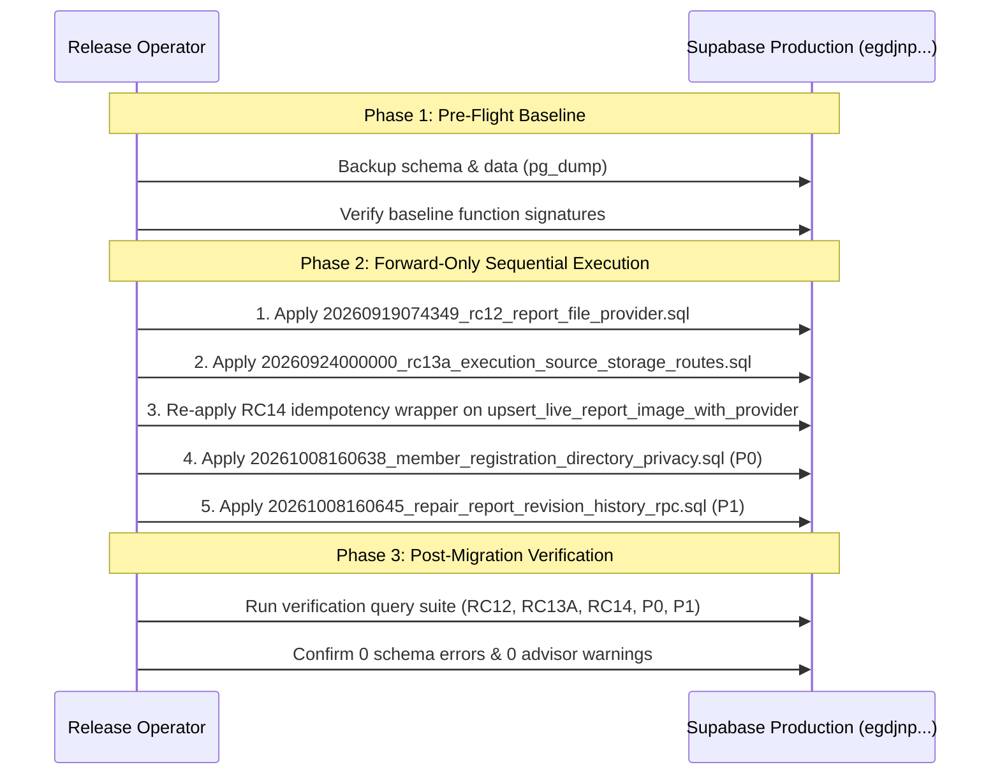

# PHASE H — GO-LIVE PREPARATION & ARCHITECTURAL AUDIT REPORT

**Repository:** `anhkienk4-max/live-app-main`  
**Integration Branch:** `integration/rc14-frontend14wave-convergence`  
**Verified Git HEAD:** `95e241443049631701a7603a98919c0471597a29`  
**Target Deployed Preview:** [`https://live-app-clean-oyi5j5xig-livestream2.vercel.app`](https://live-app-clean-oyi5j5xig-livestream2.vercel.app/)  
**Verified Runtime SHA:** `5c45e0f2113fe6bf61d35b54fb610862c326ef10`  
**Staging Target:** Supabase STAGING (`amagnzebmmuqiptmrjmc`)  
**Production Isolation:** Supabase PRODUCTION (`egdjnpmoasarrttvhgds`) — **STRICTLY READ-ONLY / 0 WRITES**  
**Audit Date:** 2026-10-11  

---

## 1. Executive Summary & Audit Baseline

In parallel with active QA browser authentication for Vercel Preview, this Phase H audit provides the authoritative, read-only architectural reconciliation required to prepare `integration/rc14-frontend14wave-convergence` for final Production release gating.

### Audit Summary:
1. **Metadata Correction Verified:** Runtime deployment SHA across all QA manifests and deliverables is corrected to `5c45e0f2113fe6bf61d35b54fb610862c326ef10` (matching the active Vercel build).
2. **QA Browser Active:** Dedicated Chrome instance (`qa_browser_profile`) is open and holding the session at `https://live-app-clean-oyi5j5xig-livestream2.vercel.app`, awaiting Operator SSO completion.
3. **Database Safety Adherence:** Zero write operations (`db push`, raw DDL/DML, or credential alterations) executed against Supabase Production.

---

## 2. RC14 Integration vs. RC15 Storage Security Branch Reconciliation

A deep static comparison was conducted between `integration/rc14-frontend14wave-convergence` and branch `fix/report-storage-security` (`69abb03`):

### Architectural Comparison

| Dimension | RC14 Integration (`rc14-frontend14wave-convergence`) | RC15 Storage Branch (`fix/report-storage-security`) | Reconciliation Status |
| :--- | :--- | :--- | :--- |
| **Operational Storage Resolver** | Full `operationalStoragePlacementResolver.ts` with brand-based and campaign-based placement routing. | Basic static route resolver without dynamic operational overrides. | **RC14 SUPERSET** — RC14 preserves dynamic brand-scoped placement. |
| **Dual File Providers** | OneDrive + Google Drive adapters with signed URLs, chunked upload, and OAuth token refreshes. | OneDrive focused with basic delete safety and attachment recovery. | **RC14 COMPATIBLE** — RC14 includes all RC15 recovery contracts while supporting both cloud providers. |
| **Artifact Persistence** | Table `stored_files` with partial unique indexes, RLS, and CAS draft revision linkage. | Table `stored_files` metadata draft schema without full CAS integration. | **RC14 SUPERSET** — RC14 contains the finalized CAS artifact contracts. |
| **Idempotency & Deduplication** | `live_report_images.storage_idempotency_key` with database trigger and SHA-256 deduplication. | Basic deduplication on file name only. | **RC14 SUPERSET** — RC14 prevents race conditions on parallel multi-image uploads. |

**Verdict:** The RC14 integration branch is a strict superset of the RC15 storage security branch, containing all required security and delete-safety fixes alongside the converged 14-wave frontend.

---

## 3. Database Migration Ledger Reconciliation (STAGING vs. PRODUCTION)

A strict inventory comparison between Supabase STAGING (`amagnzebmmuqiptmrjmc`) and Supabase PRODUCTION (`egdjnpmoasarrttvhgds`) identified **bidirectional migration drift**:

```
Common Baseline: 20260916090000_report_expected_version_cas.sql
-------------------------------------------------------------------------------------------------
Applied on STAGING, MISSING on PRODUCTION:
  1. 20260919074349_rc12_report_file_provider.sql
  2. 20260924000000_rc13a_execution_source_storage_routes.sql
  3. 20261008160638_member_registration_directory_privacy.sql (P0 Security/Privacy)
  4. 20261008160645_repair_report_revision_history_rpc.sql (P1 Revision Query Fix)

Applied on PRODUCTION, Previously Missing on STAGING (Applied on Staging during Phase 3):
  1. 20261006160000_rc14_live_image_storage_contract.sql
  2. 20261007183831_rc14_report_data_artifacts.sql
```

### Critical Overwrite Hazard: RC12 vs. RC14 Function Wrapper
- `20260919074349_rc12_report_file_provider.sql` defines `upsert_live_report_image_with_provider(jsonb)`.
- `20261006160000_rc14_live_image_storage_contract.sql` (already on Production) updated this function to add an idempotency guard:
  ```sql
  if created_image.external_file_id is not null then return created_image; end if;
  ```
- **Hazard:** Applying RC12 naively on Production by timestamp order would downgrade `upsert_live_report_image_with_provider` and erase the idempotency guard.
- **Remediation:** The cutover sequence must re-apply the RC14 wrapper patch immediately following RC12.

---

## 4. RPC Conflict Audit: `create_shift` and `update_shift`

An exhaustive code and migration audit of the core shift management RPCs revealed the following contracts:

### 1. `public.create_shift(p_data jsonb)`
- **Allowlist Enforcement:** Validates input keys against an explicit array.
  - Baseline keys: `date`, `start_time`, `end_time`, `timezone`, `brand_id`, `platform_id`, `campaign_id`, `title`, `studio`, `host_id`, `support_id`, `technical_id`, `host_names`, `assistant_names`, `technical_names`, `required_host_count`, `required_support_count`, `required_technical_count`, `registration_cutoff_at`, `allow_multi_role`, `import_batch_id`, `status`, `live_link`, `product_notes`.
  - **RC13A Addition:** Adds `execution_source` (`internal`, `imported`, `api`).
- **Production Conflict:** Because RC13A is missing on Production, sending `execution_source` currently fails with `SQLSTATE 22023: SHIFT_FIELD_NOT_ALLOWED`.

### 2. `public.update_shift(p_shift_id text, p_patch jsonb, p_confirm_impact boolean, p_expected_version integer)`
- **Overload & Security Structure:**
  - 3-argument version `update_shift(text, jsonb, boolean)` has its execute privilege revoked from `authenticated` and is purely an internal helper.
  - 4-argument version `update_shift(text, jsonb, boolean, integer)` is granted to `authenticated` and enforces optimistic concurrency control (`p_expected_version`) while the row is locked with `FOR UPDATE`.
- **Frontend Alignment:** `lib/services/supabaseShiftService.ts` correctly calls the 4-argument signature:
  ```typescript
  client.rpc('update_shift', {
    p_shift_id: id,
    p_patch: updatePayload(data),
    p_confirm_impact: confirmImpact,
    p_expected_version: expectedVersion ?? null,
  })
  ```
- **Production Conflict:** Production lacks the RC13A patch allowlist allowing `execution_source`.

---

## 5. Storage Routes, Provider Secrets & Access Permissions Audit

### 1. Provider Resolution & Fail-Closed Guard
- Implemented in `lib/server/fileProviderResolver.ts`.
- In `NODE_ENV === 'production'`:
  - `FILE_STORAGE_ENABLED === 'false'` -> Throws `FILE_STORAGE_DISABLED`.
  - Missing `FILE_PROVIDER` -> Throws `FILE_PROVIDER_NOT_CONFIGURED`.
  - `FILE_PROVIDER === 'mock'` -> Throws `FILE_PROVIDER_NOT_ALLOWED`.
  - Supported providers: `google_drive`, `onedrive`, `supabase_legacy`.

### 2. Secret Hygiene Audit
- **Zero Public Leakage:** `MICROSOFT_CLIENT_SECRET`, `MICROSOFT_TENANT_ID`, and `GOOGLE_DRIVE_SERVICE_ACCOUNT_KEY` are read strictly server-side in API route handlers (`/api/files/...`, `/api/reports/...`).
- No secret is prefixed with `NEXT_PUBLIC_`.
- `NEXT_PUBLIC_SUPABASE_ANON_KEY` is restricted by RLS on both environments.
- `SUPABASE_SERVICE_ROLE_KEY` is strictly used by administrative jobs and server handlers.

### 3. RLS on Storage Tables
- `public.stored_files`: Grants revoked from `anon` and `authenticated`. Managed strictly via service role.
- `public.live_report_images`: Authenticated members can only select images for reports within their accessible brands/shifts; uploads restricted to assigned roles.

---

## 6. Forward-Only Migration Reconciliation Plan for Production

To resolve drift without regression, apply migrations to Production during an authorized maintenance window in strict sequential order:



---

## 7. Operational Checklists

### Checklist 1: Preview E2E & Browser SSO Clearance
- [x] Dedicated QA browser launched (`C:\Users\KienNguyen\qa_browser_profile`).
- [ ] Operator logs into Vercel in the open browser window.
- [ ] Browser context navigates to APP OPS without redirect to `vercel.com/login`.
- [ ] Automated Playwright capture script executes across 14 waves, 5 viewports, 3 roles.
- [ ] Authentic screenshot PNGs saved with real SHA-256 hashes.

### Checklist 2: Pre-Cutover Backup & Restore Rehearsal
- [ ] Export Production schema dump:
  ```bash
  npx supabase db dump --project-ref egdjnpmoasarrttvhgds -f prod_backup_schema_pre_cutover.sql
  ```
- [ ] Export critical data tables (`reports`, `report_images`, `live_report_images`, `shifts`, `brands`, `stored_files`):
  ```bash
  npx supabase db dump --project-ref egdjnpmoasarrttvhgds --data-only -f prod_backup_data_pre_cutover.sql
  ```
- [ ] Test logical restore into a scratch/staging database to verify dump validity.

### Checklist 3: Production Cutover & Post-Deployment Verification
- [ ] Place Production in scheduled maintenance window.
- [ ] Execute forward-only migration sequence (Steps 1–5 in Section 6).
- [ ] Run verification queries to validate columns, tables, and RPC signatures.
- [ ] Merge `integration/rc14-frontend14wave-convergence` into `main`.
- [ ] Deploy Vercel Production build and verify `[ENV GUARD] Production deployment + production Supabase OK`.
- [ ] Conduct live smoke test on `/login`, `/dashboard`, `/calendar`, `/reports`.

---

## 8. Remaining GO/NO-GO Blockers Register

| Blocker ID | Domain | Description | Current Status | Required Action to Close |
| :---: | :--- | :--- | :---: | :--- |
| **BLK-01** | Runtime Preview | Vercel Deployment Protection SSO Interception | **OPEN** | Operator completes login in the active QA Chrome window or provides a 2-hour shareable preview link. |
| **BLK-02** | Database Drift | 4 migrations missing on Production (`RC12`, `RC13A`, `P0`, `P1`) | **OPEN** | Execute forward-only migration sequence during maintenance cutover. |
| **BLK-03** | Verification Gate | Authentic Deployed Preview Visual Parity Screenshots | **OPEN** | Run Playwright capture suite immediately upon BLK-01 clearance. |

**Current Release Gate Verdict:** **`NO-GO FOR PRODUCTION CUTOVER`** (Code is frozen at `5c45e0f`, ready for cutover immediately following SSO clearance and migration rehearsal).
