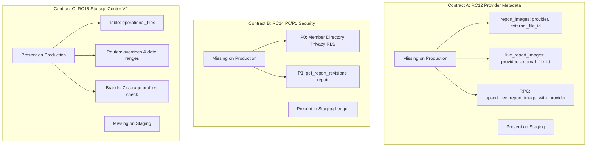

# RC STORAGE DATABASE COMPATIBILITY REPORT

**Project:** APP OPS LIVESTREAM PLATFORM  
**Date:** 2026-10-11T20:39:00+07:00  
**Target Environments:** Staging (`amagnzebmmuqiptmrjmc`) & Production (`egdjnpmoasarrttvhgds`)  
**Strict Constraint:** Zero migration writes to Production or Staging in this phase.  

---

## 1. SCHEMA-LEVEL DRIFT ANALYSIS (CONTRACTS A, B, C)

A rigorous three-way comparative audit between the codebase, Staging database, and Production database revealed distinct contract states that must be reconciled forward-only:



### Detailed Breakdown

| Contract Component | Object / Schema Element | Current Production (`egdjnp...`) | Current Staging (`amagnz...`) | Codebase Requirement (`rc/convergence...`) | Resolution Strategy |
| :--- | :--- | :--- | :--- | :--- | :--- |
| **Contract A** | `report_images.provider` | **MISSING** | Present | Required | Forward-only compatibility migration (idempotent `add column if not exists`) |
| **Contract A** | `report_images.external_file_id` | **MISSING** | Present | Required | Forward-only compatibility migration |
| **Contract A** | `live_report_images.provider` | **MISSING** | Present | Required | Forward-only compatibility migration |
| **Contract A** | `live_report_images.external_file_id` | **MISSING** | Present | Required | Forward-only compatibility migration |
| **Contract A** | `upsert_live_report_image_with_provider(jsonb)` | **MISSING** | Present | Required | Forward-only compatibility RPC creation |
| **Contract B** | `users` Member Directory Privacy (P0) | **MISSING** | Present (`20261008160638`) | Required | Source from original P0 migration authority; apply to Production during cutover |
| **Contract B** | `get_report_revisions` Repair (P1) | **MISSING** | Present (`20261008160645`) | Required | Source from original P1 migration authority; apply to Production during cutover |
| **Contract C** | `operational_files` Table & RLS | **PRESENT** | **MISSING** | Required | Forward-only migration staged (`20261011092051`); apply to Staging during rehearsal |
| **Contract C** | `operational_storage_routes.period_label_overrides` | **PRESENT** | **MISSING** | Required | Forward-only migration staged (`20261011091925`); apply to Staging during rehearsal |
| **Contract C** | `brands.storage_profile` 7-Profile Check | **PRESENT** | **MISSING** | Required | Forward-only migration staged (`20261011091925`); apply to Staging during rehearsal |

---

## 2. FORWARD-ONLY MIGRATION DESIGN RULES

To prevent corruption, drift, or catastrophic service disruption, the following rules are strictly enforced:

1. **NO Replay of Obsolete RC12/RC13A Migrations:**
   - Obsolete migrations that attempt to replay unhardened versions of `create_shift` or `update_shift` are permanently excluded.
2. **NO Hardcoded Function MD5 Preflights:**
   - Brittle MD5 checksums of function source strings have been replaced with **structural signature guards** (`pg_proc` argument type checks and parameter count checks).
3. **NO Re-application to Staging Ledger:**
   - Staging already records P0 (`20261008160638`) and P1 (`20261008160645`) in `supabase_migrations.schema_migrations`. They will NOT be re-executed or duplicated.
4. **NO Direct Manipulation of `schema_migrations` Table:**
   - Direct SQL inserts into `supabase_migrations.schema_migrations` are strictly prohibited. All ledger updates must occur through genuine Supabase CLI migration workflows.
5. **Idempotent Column & Constraint Addition:**
   - All schema additions use `ADD COLUMN IF NOT EXISTS` and `IF NOT EXISTS` constraint guards.

---

## 3. COMPATIBILITY MIGRATION SCRIPT DESIGN

### Compatibility Migration A: Provider Metadata (Production Forward-Only)
```sql
-- Migration: 20261011120000_rc12_provider_metadata_forward_compat.sql
-- Idempotent forward-only patch for Production environments lacking RC12 provider columns.
-- Preserves actual Production schema: report_id (not shift_id), uploaded_by (not created_by),
-- existing unique constraint (report_id, file_url), and atomic revision audit tracking.

begin;

alter table public.report_images
  add column if not exists provider text null,
  add column if not exists external_file_id text null;

alter table public.live_report_images
  add column if not exists provider text null,
  add column if not exists external_file_id text null;

alter table public.report_images
  drop constraint if exists report_images_file_provider_pair,
  add constraint report_images_file_provider_pair check (
    (provider is null and external_file_id is null)
    or (provider in ('google_drive', 'onedrive') and btrim(external_file_id) <> '')
  );

alter table public.live_report_images
  drop constraint if exists live_report_images_file_provider_pair,
  add constraint live_report_images_file_provider_pair check (
    (provider is null and external_file_id is null)
    or (provider in ('google_drive', 'onedrive') and btrim(external_file_id) <> '')
  );

-- Function for atomic report image upload with cloud provider metadata
create or replace function public.upload_report_image_with_provider(
  p_report_id text,
  p_storage_path text,
  p_image_url text,
  p_original_name text,
  p_mime_type text,
  p_size_bytes bigint,
  p_image_type text,
  p_provider text,
  p_external_file_id text
)
returns public.report_images
language plpgsql
security definer
set search_path = ''
as $$
declare
  created_image public.report_images;
begin
  if p_provider not in ('google_drive', 'onedrive')
    or p_external_file_id is null
    or btrim(p_external_file_id) = '' then
    raise exception using errcode = '22023', message = 'REPORT_FILE_PROVIDER_METADATA_INVALID';
  end if;

  created_image := public.upload_report_image(
    p_report_id,
    p_storage_path,
    p_image_url,
    p_original_name,
    p_mime_type,
    p_size_bytes,
    p_image_type
  );

  update public.report_images
  set provider = p_provider,
      external_file_id = p_external_file_id
  where id = created_image.id
  returning * into created_image;

  return created_image;
end;
$$;

-- Function for atomic live report image upsert with provider metadata
-- Preserves existing upsert_live_report_image validation, RLS, CAS, idempotency and revision tracking
create or replace function public.upsert_live_report_image_with_provider(p_data jsonb)
returns public.live_report_images
language plpgsql
security definer
set search_path = ''
as $$
declare
  created_image public.live_report_images;
  provider_value text;
  external_id text;
begin
  provider_value := p_data->>'provider';
  external_id := p_data->>'external_file_id';
  if provider_value not in ('google_drive', 'onedrive')
    or external_id is null
    or btrim(external_id) = '' then
    raise exception using errcode = '22023', message = 'REPORT_FILE_PROVIDER_METADATA_INVALID';
  end if;

  created_image := public.upsert_live_report_image(
    p_data - 'provider' - 'external_file_id'
  );

  -- Do not overwrite the winner of an idempotent retry with the redundant object.
  if created_image.external_file_id is not null then return created_image; end if;

  update public.live_report_images
  set provider = provider_value,
      external_file_id = external_id
  where id = created_image.id
  returning * into created_image;

  return created_image;
end;
$$;

revoke all on function public.upload_report_image_with_provider(text, text, text, text, text, bigint, text, text, text) from public, anon, authenticated;
revoke all on function public.upsert_live_report_image_with_provider(jsonb) from public, anon, authenticated;

grant execute on function public.upload_report_image_with_provider(text, text, text, text, text, bigint, text, text, text) to authenticated;
grant execute on function public.upsert_live_report_image_with_provider(jsonb) to authenticated;

commit;
```

### Compatibility Migration C: Storage Center V2 (Staging Forward-Only)
Staged in repository as:
- `supabase/migrations/20261011091925_rc15_storage_route_prerequisites.sql`
- `supabase/migrations/20261011092015_rc15_shift_rpc_compatibility.sql`
- `supabase/migrations/20261011092051_rc15_operational_files.sql`

---

## 4. DATABASE CLONE REHEARSAL & ROLLBACK PLAN

Before executing any database cutover:

1. **Rehearsal on Fresh Database Clone:**
   - Spin up a temporary Supabase project or local PostgreSQL container cloned from Production snapshot.
   - Apply compatibility migrations in sequence:
     1. `20261008160638_p0_member_directory_privacy.sql`
     2. `20261008160645_p1_report_revisions_repair.sql`
     3. `20261011120000_rc12_provider_metadata_forward_compat.sql`
     4. `20261011091925_rc15_storage_route_prerequisites.sql`
     5. `20261011092015_rc15_shift_rpc_compatibility.sql`
     6. `20261011092051_rc15_operational_files.sql`
   - Run verification query `scripts/storage/rc15-production-readiness.sql`.
   - Run automated contract tests against the cloned instance.
2. **Backup & Rollback Safeguards:**
   - Take point-in-time snapshot before running migrations.
   - All table alterations are purely additive (no `DROP COLUMN`, no `ALTER TYPE`, no data truncation).
   - In case of unexpected failure, rollback involves reverting newly created functions and removing newly added nullable columns.
