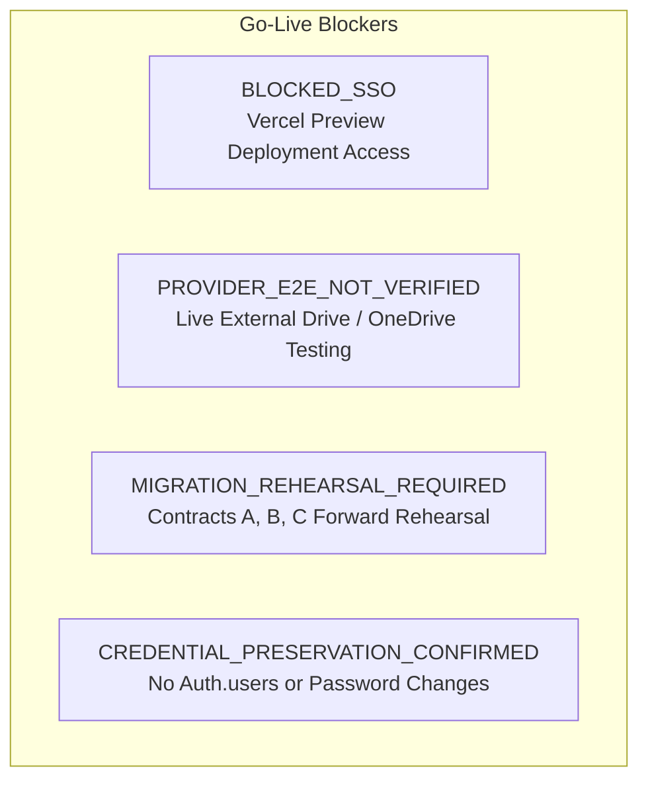

# RELEASE CANDIDATE BLOCKERS & GO-LIVE GATES

**Target Branch:** `rc/convergence-rc14-rc15`  
**Candidate Commit HEAD:** `dfa41407df7422f281898da8bb20bc695b27a3c3`  
**Date:** 2026-10-11T20:40:20+07:00  

---

## 1. CURRENT BLOCKER INVENTORY

Before declaring this Release Candidate ready for production deployment, the following 4 blockers must be resolved through operational review:

### Blocker 1: `BLOCKED_SSO` (Vercel Preview Access)
- **Status:** **BLOCKED**
- **Impact:** Automated browser agents cannot access deployed Vercel preview URLs (`https://live-app-clean-oyi5j5xig-livestream2.vercel.app/`) because Vercel requires Google Single Sign-On authentication.
- **Action Required:** The Operator must complete interactive Google SSO login in the running browser session (`task-4059`). Once completed, automated preview visual UAT can proceed.

### Blocker 2: `PROVIDER_E2E_NOT_VERIFIED` (Real File Provider E2E)
- **Status:** **BLOCKED (BY DESIGN)**
- **Impact:** While all 119 storage mock and unit tests pass with 100% fidelity, live read/write operations against actual external Google Drive and OneDrive folders with real configured credentials have not been performed in production.
- **Action Required:** Must be marked as `PROVIDER_E2E_NOT_VERIFIED` until verified in a controlled staging rehearsal with real OAuth tokens and Drive folder IDs.

### Blocker 3: Database Migration Rehearsal Required
- **Status:** **BLOCKED**
- **Impact:** Production database lacks Contract A (RC12 provider metadata) and Contract B (P0/P1 privacy/revisions), while Staging database lacks Contract C (Storage Center V2 schema).
- **Action Required:** Perform a full forward-only compatibility rehearsal on an isolated database clone before any cutover:
  1. Rehearse Contract A on a Production clone.
  2. Rehearse Contract B on a Production clone.
  3. Rehearse Contract C on Staging.
  4. Verify zero data loss and verify `scripts/storage/rc15-production-readiness.sql`.

### Blocker 4: Production Credential Preservation
- **Status:** **SATISFIED (PRESERVED)**
- **Impact:** Strictly adhering to the Operator directive: "GIỮ NGUYÊN MẬT KHẨU HIỆN TẠI".
- **Condition:** Zero password changes, zero bcrypt hash restores, zero `updateUserById` calls, zero SQL modifications to `auth.users`. All credentials remain untouched.

---

## 2. GO-LIVE CRITERIA CHECKLIST

The Release Candidate will only be promoted to Production when all following conditions are met:

| Condition | Verification Method | Current Status |
| :--- | :--- | :---: |
| **Branch Convergence & Tests** | `npm run type-check && npm run lint && npm run build` + 224 Node tests pass | **MET (100%)** |
| **Zero Lost Routes / Features** | 35 application routes compile and function | **MET (100%)** |
| **Vercel Preview Visual UAT** | Operator authenticates SSO and approves live rendered pages | **PENDING (BLOCKED_SSO)** |
| **Database Migration Rehearsal** | Compatibility migrations pass on clone without errors | **PENDING** |
| **Provider Real Credentials E2E** | Live test upload to verified Google Drive / OneDrive folder | **PENDING (PROVIDER_E2E_NOT_VERIFIED)** |
| **Operator Final Sign-Off** | Explicit approval to trigger cutover | **PENDING** |
