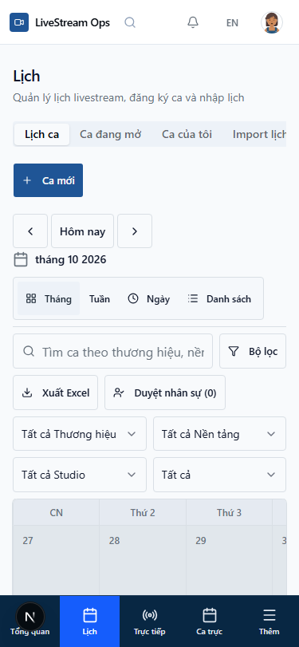
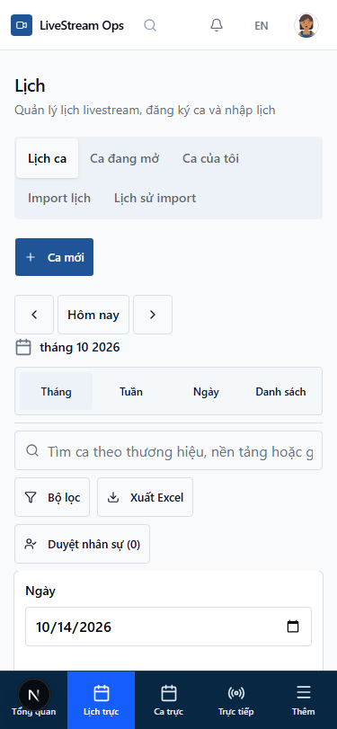
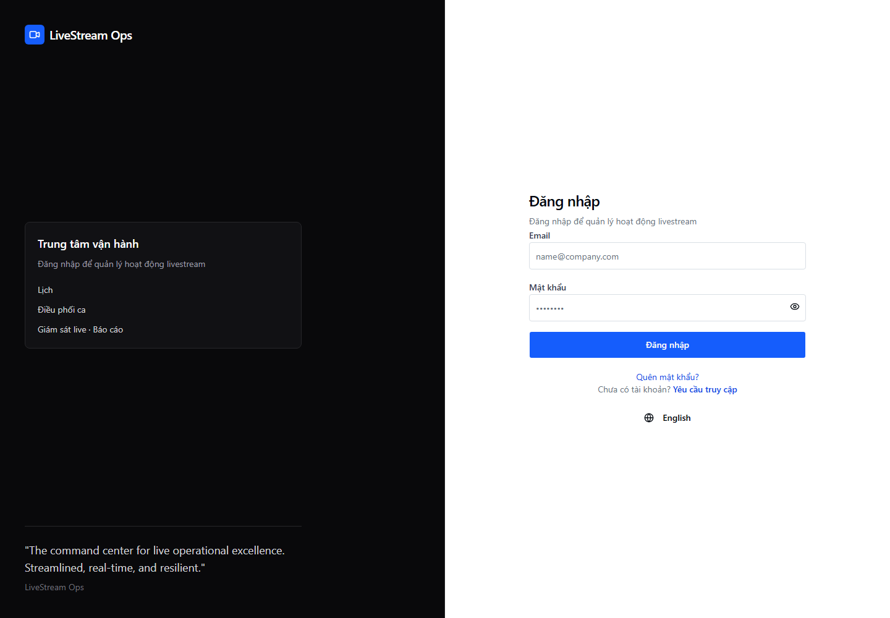
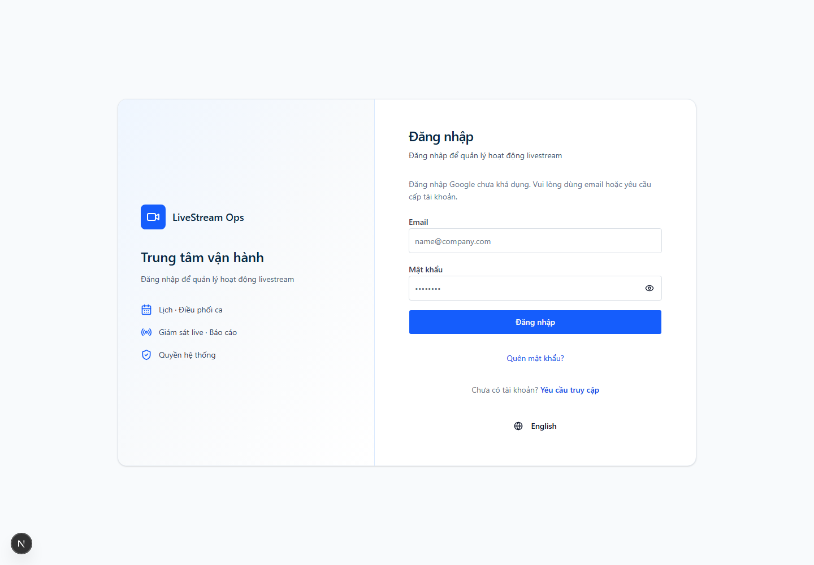

# Actual Playwright screenshots

Before application captures use baseline 7f5efbf local fixtures; after application captures use the final RC1.7D candidate integrated with main 371426b and local fixtures. The same calendar date/empty fixture is used for comparable pairs. Dense agenda is a separate imported local fixture. Public auth before is the live unauthenticated Production site; after is local Supabase mode with no credentials and provider unavailable. Captures are first viewport views of the scrolling application shell; they do not prove every row is visually audited. Next dev indicator may be visible on local captures.

| Screen | Width | Before | After |
|---|---|---|---|
| admin-dashboard | 375 | [PNG](screenshots/admin-dashboard-375-before.png) | [PNG](screenshots/admin-dashboard-375-after.png) |
| admin-dashboard | 768 | [PNG](screenshots/admin-dashboard-768-before.png) | [PNG](screenshots/admin-dashboard-768-after.png) |
| admin-dashboard | 1440 | [PNG](screenshots/admin-dashboard-1440-before.png) | [PNG](screenshots/admin-dashboard-1440-after.png) |
| leader-dashboard | 375 | [PNG](screenshots/leader-dashboard-375-before.png) | [PNG](screenshots/leader-dashboard-375-after.png) |
| leader-dashboard | 768 | [PNG](screenshots/leader-dashboard-768-before.png) | [PNG](screenshots/leader-dashboard-768-after.png) |
| leader-dashboard | 1440 | [PNG](screenshots/leader-dashboard-1440-before.png) | [PNG](screenshots/leader-dashboard-1440-after.png) |
| member-dashboard | 375 | [PNG](screenshots/member-dashboard-375-before.png) | [PNG](screenshots/member-dashboard-375-after.png) |
| member-dashboard | 768 | [PNG](screenshots/member-dashboard-768-before.png) | [PNG](screenshots/member-dashboard-768-after.png) |
| member-dashboard | 1440 | [PNG](screenshots/member-dashboard-1440-before.png) | [PNG](screenshots/member-dashboard-1440-after.png) |
| calendar | 375 | [PNG](screenshots/calendar-375-before.png) | [PNG](screenshots/calendar-375-after.png) |
| calendar | 768 | [PNG](screenshots/calendar-768-before.png) | [PNG](screenshots/calendar-768-after.png) |
| calendar | 1440 | [PNG](screenshots/calendar-1440-before.png) | [PNG](screenshots/calendar-1440-after.png) |
| shifts | 375 | [PNG](screenshots/shifts-375-before.png) | [PNG](screenshots/shifts-375-after.png) |
| shifts | 768 | [PNG](screenshots/shifts-768-before.png) | [PNG](screenshots/shifts-768-after.png) |
| shifts | 1440 | [PNG](screenshots/shifts-1440-before.png) | [PNG](screenshots/shifts-1440-after.png) |
| staffing | 375 | [PNG](screenshots/staffing-375-before.png) | [PNG](screenshots/staffing-375-after.png) |
| staffing | 768 | [PNG](screenshots/staffing-768-before.png) | [PNG](screenshots/staffing-768-after.png) |
| staffing | 1440 | [PNG](screenshots/staffing-1440-before.png) | [PNG](screenshots/staffing-1440-after.png) |
| reports | 375 | [PNG](screenshots/reports-375-before.png) | [PNG](screenshots/reports-375-after.png) |
| reports | 768 | [PNG](screenshots/reports-768-before.png) | [PNG](screenshots/reports-768-after.png) |
| reports | 1440 | [PNG](screenshots/reports-1440-before.png) | [PNG](screenshots/reports-1440-after.png) |
| live | 375 | [PNG](screenshots/live-375-before.png) | [PNG](screenshots/live-375-after.png) |
| live | 768 | [PNG](screenshots/live-768-before.png) | [PNG](screenshots/live-768-after.png) |
| live | 1440 | [PNG](screenshots/live-1440-before.png) | [PNG](screenshots/live-1440-after.png) |
| login (Production → local) | 375 | [PNG](screenshots/login-375-before.png) | [PNG](screenshots/login-375-after.png) |
| login (Production → local) | 768 | [PNG](screenshots/login-768-before.png) | [PNG](screenshots/login-768-after.png) |
| login (Production → local) | 1440 | [PNG](screenshots/login-1440-before.png) | [PNG](screenshots/login-1440-after.png) |
| register (Production → local) | 375 | [PNG](screenshots/register-375-before.png) | [PNG](screenshots/register-375-after.png) |
| register (Production → local) | 768 | [PNG](screenshots/register-768-before.png) | [PNG](screenshots/register-768-after.png) |
| register (Production → local) | 1440 | [PNG](screenshots/register-1440-before.png) | [PNG](screenshots/register-1440-after.png) |

## Additional interactions (local fixtures)

- [PNG](screenshots/dense-agenda-375.png)
- [PNG](screenshots/filters-375.png)
- [PNG](screenshots/more-375.png)
- [PNG](screenshots/payroll-detail-375.png)

## Priority comparisons

### Calendar 375 — baseline / candidate

### Login 1440 — Production before / local candidate

